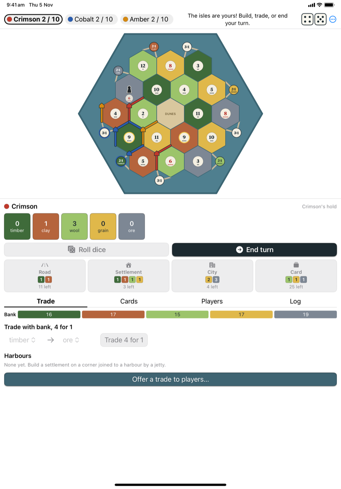
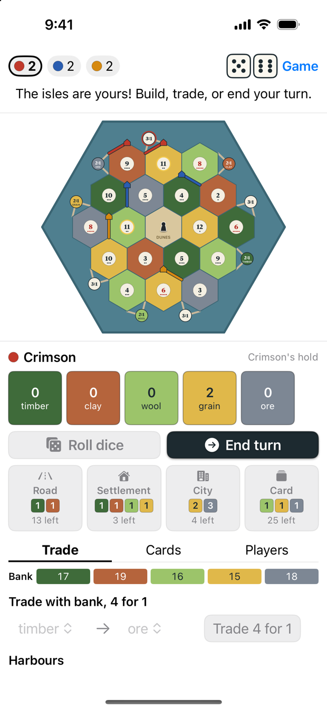
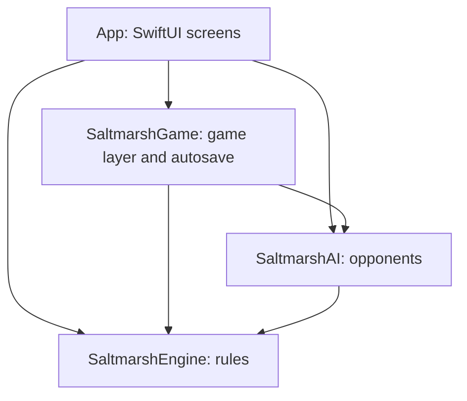

<div align="center">


# Saltmarsh Isles

**Settle a hex-tile island, trade for what you lack, and race to 10 points, on iPhone, iPad and Mac.**


[](LICENSE)

[Install on a Mac](#install-on-a-mac) • [iPhone and iPad](#iphone-and-ipad) • [Build from source](#build-from-source) • [How to play](#how-to-play) • [Status](#status) • [Architecture](#architecture) • [Contributing](#contributing)


&nbsp;&nbsp;


</div>

---

Saltmarsh Isles is a native SwiftUI board game for two to four players sharing one device. Every
game deals a new island of 19 tiles and nine harbours, and any seat can be a person or the computer.

- **Pass and play.** A handover screen sits between human players, so nobody sees the next hand.
- **Picks up where you left off.** Your game saves after every move and reopens when you return.
- **Rolls you can feel.** The dice tumble, paying hexes celebrate, resources pulse as they arrive,
  and a win ends in confetti. Reduce Motion turns the animation off.
- **Up to five named saves.** Save, load and start games from the **File** menu on Mac and the
  **Game** button on iPhone and iPad.
- **Rules at hand.** Searchable help is in the **Help** menu on Mac and the **Game** button on
  iPhone and iPad.

## Install on a Mac

Download `SaltmarshIsles-<version>.dmg` from
[Releases](https://github.com/psenger/saltmarsh-isles/releases), open it, and drag
**SaltmarshIsles** to **Applications**. It runs on macOS 14 or later, on Apple silicon and Intel.
Until the first release is published, [build from source](#build-from-source).

The app is not signed with an Apple Developer ID or notarized, so macOS blocks it the first time:

1. Open **SaltmarshIsles** from Applications. macOS says it can't verify the app. Click **Done**.
2. Open **System Settings**, then **Privacy & Security**, and scroll down to **Security**.
3. Click **Open Anyway** beside the message about SaltmarshIsles, and confirm with your password.

You only do this once. On macOS 14 you can instead Control-click the app and choose **Open**.

## iPhone and iPad

There is no download for iPhone or iPad, because Apple only installs apps from the App Store,
TestFlight or Xcode. To play on your own device, build it from source with Xcode:

1. In Xcode, open **Settings**, then **Accounts**, and sign in with your Apple ID. A free account
   works, but an app it installs stops opening after 7 days until you build it again.
2. Find your team ID. It is the `OU` value this command prints:

   ```bash
   security find-certificate -c "Apple Development" -p | openssl x509 -noout -subject
   ```

3. Create `Config/Local.xcconfig` with your team ID and a bundle identifier of your own. Git
   ignores this file.

   ```
   DEVELOPMENT_TEAM = ABCDE12345
   PRODUCT_BUNDLE_IDENTIFIER = com.yourname.SaltmarshIsles
   ```

4. Turn on **Developer Mode** on the device, under **Settings**, then **Privacy & Security**.
5. Connect the device, open `SaltmarshIsles.xcodeproj`, choose the device as the destination, and
   press **Cmd-R**.

The Mac and simulator builds sign ad hoc, so they need none of this.

## Build from source

You need a Mac with Xcode 26 or later, because the app icon uses the `.icon` format. The project is
tested with Xcode 27.2 and needs no other dependencies.

```bash
git clone https://github.com/psenger/saltmarsh-isles.git
cd saltmarsh-isles
open SaltmarshIsles.xcodeproj
```

Choose the `SaltmarshIsles` scheme and a destination, then press **Cmd-R**.

macOS only loads help pages for an app in an Applications folder, so the Help window is blank under
**Cmd-R**. To check it on a Mac, build and run from `~/Applications`:

```bash
make run
```

## How to play

Roll two dice each turn. Every settlement and city next to a tile with that number collects its
resource: timber, clay, wool, grain or ore. Spend them on these:

| Build | Cost | Points |
|---|---|---|
| Road | 1 timber, 1 clay | 0 |
| Settlement | 1 timber, 1 clay, 1 wool, 1 grain | 1 |
| City (upgrades a settlement) | 2 grain, 3 ore | 2 |
| Development card | 1 wool, 1 grain, 1 ore | Depends on the card |

The longest road (5 or more) and the largest army (3 or more Knights) are worth 2 points each. The
first player to reach 10 points on their own turn wins.

- **Trading:** deal with the bank at 4 for 1, at better rates through the harbours you hold, or
  directly with other players.
- **The robber:** a rolled 7 makes anyone holding more than 7 cards give up half. The roller then
  moves the robber to block a tile and steals a card.
- **Development cards:** a deck of 25 holds Knight, Victory point, Road crew, Bumper harvest and
  Corner the market cards.

The app's help covers all of this, and the [build spec](saltmarsh-isles-spec.md) has the exact rules.

## Status

In development.

| Area | State |
|---|---|
| Rules engine | Done |
| Game screen, animation and in-app help | Done |
| Pass and play for 2 to 4 people | Done |
| Resuming the game in progress, and five named saves | Done |
| AI opponents | Deckhand, Sailor and Mate play by heuristics: spot scoring, build priorities, robber targeting and trades that complete a build. Captain and Admiral play as Mate until the search opponents land |
| `ai-bench` benchmark tool | Placeholder only |

Next come the search-based Captain and Admiral and the `ai-bench` benchmark.

## Building from the command line

```bash
make mac    # build for Mac
make ios    # build for the iPhone 15 Pro simulator on iOS 17.5
make dmg    # build the Mac disk image into build/SaltmarshIsles-<version>.dmg
```

`make ios` and the UI tests expect the iOS 17.5 simulator runtime with an iPhone 15 Pro. Install it
from Xcode's **Settings**, then **Components**, or change the destination to a simulator you have.
`make dmg` makes a Release build for Apple silicon and Intel, signed ad hoc. The version comes from
`MARKETING_VERSION` in `project.yml`.

The Xcode project is generated from `project.yml`. After adding or removing files, or changing
`project.yml`, regenerate it with [XcodeGen](https://github.com/yonaskolb/XcodeGen):

```bash
brew install xcodegen
make project
```

After changing the rules text in `Sources/SaltmarshGame/Help.swift`, rebuild the Mac help book and
its search index with `make help`.

## Testing

```bash
swift test
```

This runs the engine, AI and game tests, plus every scenario in
[`saltmarsh-isles.feature`](saltmarsh-isles.feature). That file describes each player interaction
in plain Given/When/Then language, and the test suite executes it directly.

To run the UI tests on the iPhone simulator:

```bash
xcodebuild test -project SaltmarshIsles.xcodeproj -scheme SaltmarshIsles \
  -destination 'platform=iOS Simulator,name=iPhone 15 Pro,OS=17.5' \
  -only-testing:AppUITests
```

`make test` runs `swift test` and then the full test scheme on the Mac. The Mac UI test runner can
fail with "Authentication cancelled" unless someone is there to approve its prompt.

## Architecture

The rules live in a pure Swift engine with no UI code. The AI and the screens both go through it,
and an opponent receives a `PlayerView` that holds only what that seat is allowed to see.



| Path | What it is |
|---|---|
| `App/` | The SwiftUI app: views, app entry point and icon. |
| `AppUITests/` | UI tests that drive the real screen. |
| `Sources/SaltmarshEngine/` | The rules engine. |
| `Sources/SaltmarshAI/` | The opponent interface, the heuristic opponents and the move resolver. |
| `Sources/SaltmarshGame/` | The game layer between the engine and the screen, including the help text. |
| `Sources/SaltmarshTestSupport/` | State helpers and seeded game builders shared by the tests. |
| `Tests/` | Engine, AI, game and Gherkin tests. |
| `saltmarsh-isles-spec.md` | The build spec: rules, data model, UI, AI plan and test checklist. |
| `saltmarsh-isles.feature` | Gherkin scenarios for every player interaction. |
| `Config/` | Signing settings. Your own team goes in the untracked `Config/Local.xcconfig`. |
| `docs/images/` | Screenshots used in this README. |

## Web prototype

The game began as a rapid prototype in a single HTML file, which proved the rules and screen flow
before the native build. The app doesn't use it. To try it, open
[`prototype/saltmarsh.html`](prototype/saltmarsh.html) in any browser.

<details>
<summary>Prototype files and test scripts</summary>

| Path | What it is |
|---|---|
| `prototype/saltmarsh.html` | The whole prototype in one file. |
| `prototype/tests/playgame.py` | Plays a full 3-player game with bots in Chrome, records a video and checks rule invariants after every action. |
| `prototype/tests/steps.py` | Captures every screen of a rolled 7 and of a Knight, into `steps/`. |
| `prototype/media/` | The recording of a full bot game, its final frame, and step-by-step screenshots. |

The test scripts need `pip install playwright`. They still point to another machine, so before
running them, update these paths to match yours:

- **`playgame.py`:** `GAME` on line 9 and `executable_path` on line 97.
- **`steps.py`:** `executable_path` on line 8 and the `goto` path on line 11.

Run the full game with `python3 playgame.py <output-folder>`.

</details>

## Contributing

Bug reports, rule corrections and new features are all welcome. Open an issue with the
[bug report](https://github.com/psenger/saltmarsh-isles/issues/new?template=bug_report.yml) or
[feature request](https://github.com/psenger/saltmarsh-isles/issues/new?template=feature_request.yml)
form, and read [CONTRIBUTING.md](CONTRIBUTING.md) before sending a pull request. It covers the
toolchain, how the tests and the Gherkin scenarios fit together, and the commit style.

## License

[MIT](LICENSE) © 2026 Philip A. Senger

---

<div align="center">

**A pass-and-play island board game, written natively for Apple devices.**

[Build spec](saltmarsh-isles-spec.md) • [Scenarios](saltmarsh-isles.feature) • [Report a bug](https://github.com/psenger/saltmarsh-isles/issues/new?template=bug_report.yml) • [Request a feature](https://github.com/psenger/saltmarsh-isles/issues/new?template=feature_request.yml)

</div>
